# Raina Clock

Raina Clock is a bedside alarm clock for the **Cheap Yellow Display** (ESP32-2432S028R, a 2.8" 320x240 touch screen).
- It shows a big clock with the weather beside it.
- It wakes you with a named alarm.
- It warns you about rain or storms in short chat-style messages.
- It keeps a small daily to-do list.

You set everything on the touch screen or from a phone on the same Wi-Fi.

It is built on [cyd-weather-station](https://github.com/nicholaswilde/cyd-weather-station) by Nicholas Wilde (Apache-2.0).

  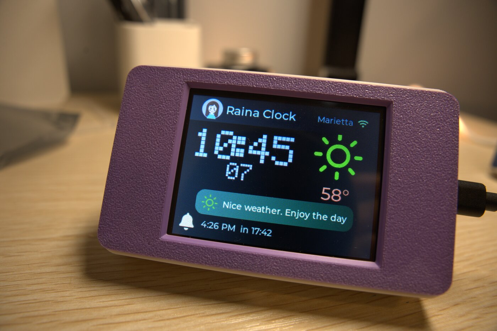

  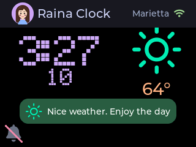
  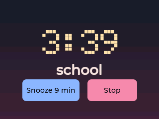

## Special features

1. **Cool lilac display.** Big lilac pixel digits on black, easy to read across a dark room and calm at night.
2. **Uncluttered UX.** No tab bar and no small buttons along the edges. Each page shows one thing.
3. **Tap blank space to move.** A tap anywhere empty slides up a menu of four big buttons: Clock, Weather, To-do, Setup.
4. **Full settings from your phone.** Scan the QR code on the clock to open its web pages. From there you set the alarm, the to-do list and every app setting (Wi-Fi, location, units, theme, time zone), and read the event log or update the firmware.
5. **Polished keyboards.**
   - Big, phone-style keys for the Wi-Fi password and the alarm name.
   - The name keyboard has a full-width name box and a ⌫ key beside "m".
   - Its last row is Cancel | Space | OK.
6. **Icons everywhere.** Weather icons on the clock and the forecast, a bell for the alarm (slashed when off), a down arrow for count down, and a pencil for the name.
7. **Named alarms.** Give the alarm a name such as "school" or "medicine". When it rings, the name shows in bold under the time, so you know why you set it.

## Contents

- [Special features](#special-features)
- [Features](#features)
- [Screens](#screens)
- [Flows](#flows)
- [Phone pages and API](#phone-pages-and-api)
- [Hardware](#hardware)
- [Case](#case)
- [Build and flash](#build-and-flash)
- [Project layout](#project-layout)
- [Credits and licenses](#credits-and-licenses)

## Features

### Clock

- **Digits:** large lilac digits in a square-pixel font (Electronic Highway Sign). Hours and minutes sit on one line, the seconds below, and the colon stays on.
- **Weather:** the current weather icon and temperature sit beside the time.
- **Alarm bell:** at the bottom left. It is slashed when no alarm is set; otherwise it shows the alarm time and the time left. Tap it to set the alarm.

### Alarm

- **Types:** there is one alarm. It rings at a time of day (every day or once) or as a **count down** (hours and minutes from now).
- **Keypad:** a big number keypad with AM/PM buttons. A single down-arrow button switches between time of day and count down.
- **Alarm name:**
  - Tap the pencil button to type a name on a full-screen keyboard: lowercase letters and spaces, up to 20 characters.
  - When the alarm rings, the name shows in bold under the time, for example "school" or "medicine".
- **Ringing screen:** **Snooze** (9 minutes by default) and **Stop**. Touch keeps working while it rings.
- **No answer:** an alarm nobody answers snoozes itself after 5 minutes. After the third time it stops for good.
- **Sound:** a loud built-in beep that needs no SD card. Volume goes from 0 to 100 %.

### Weather messages

A short message bubble on the Clock page, like a chat message, chosen from the hourly forecast:

| Situation | Message |
|---|---|
| Thunderstorm now | Storm now. Stay inside! |
| Thunderstorm in the next 3 hours | Storm coming. Stay inside |
| Snow in the next 3 hours | Snow soon. Dress warm |
| Rain now | Raining. Take an umbrella |
| Rain in 1-2 hours | Rain in ~40 min. Umbrella! |
| Rain in 3-8 hours | Rain later. Pack an umbrella |
| A night hour at or below freezing in the next 12 hours | Freezing night. Dress warm |
| A drop of 10 °F (6 °C) within 3 hours | Getting colder. Grab a jacket |
| A rise of 10 °F (6 °C) within 3 hours | Warming up. Dress light |
| 95 °F (35 °C) or more | Hot today. Drink water |
| Fog | Foggy. Drive carefully |
| None of the above | Nice weather. Enjoy the day ("Calm weather today" when cloudy) |

- **Priority:** the most urgent message wins. Urgent ones blink their icon: storm, snow, rain soon and freezing night.
- **Updates:** the forecast comes from Open-Meteo (no API key) every 15 minutes. The message is re-checked every 15 seconds, so "Rain in ~N min" counts down.

### Weather page

- **Hourly:** a Google-style graph of the next 24 hours, one point every 3 hours, with the temperature above each point and the sky and the hour below.
- **Night icons:** clear nights show a crescent moon.
- **Daily:** the next 7 days, with highs, lows and the chance of rain.

### To-do

- **Day page:** like a bullet journal, urgent tasks come first, then the rest, with done tasks ticked in green. A tap ticks a task.
- **Carry-over:** open tasks from earlier days stay on the list until they are done.
- **Phone:** you write and plan the list on your phone; scan the QR code on the page to open it.
- **Storage:** the list is stored on the clock, nothing in the cloud.

### Setup

- **Sidebar:** five sections on the left:

  | Section | What you set |
  |---|---|
  | **Network** | Wi-Fi (scan and type the password on a keyboard) |
  | **Weather** | Zip code and time zone |
  | **Audio** | Alarm volume and a test sound |
  | **Look** | Theme, brightness, units and 24-hour time |
  | **System** | Sensor and version |

- **QR button:** opens the phone pages.

### Reliability

- **Event log:** kept on flash and shown at `/log`. It records the boot reason, Wi-Fi changes, the alarm (ring, snooze, stop), slow loops and names saved.
- **Watchdog:** the clock restarts if the main loop stops for 60 seconds.
- **Settings backup:** Wi-Fi, zip code, time zone and the alarm are also kept in `/config.json`. If the settings store is ever empty at start, the clock restores them from that file.
- **Responsive touch:** the web server runs in its own task, so the touch screen stays responsive while a phone is connected.

## Screens

| | | |
|---|---|---|
|  Clock with the weather and a calm message | 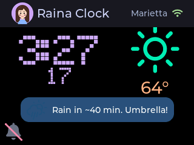 Rain coming | 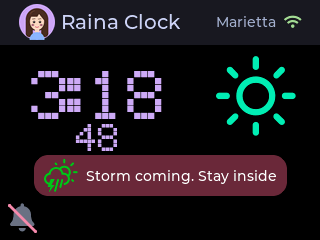 Storm coming (blinking icon) |
| 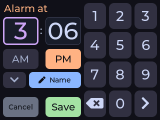 Set the alarm time | 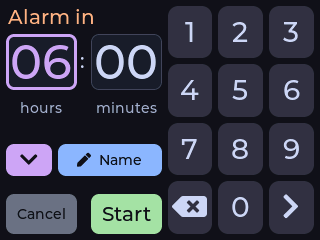 Count down (down arrow lit) | 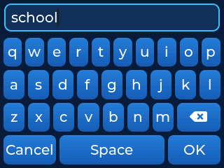 Name keyboard |
|  Ringing, with the name in bold | 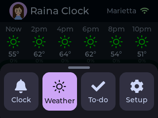 Page menu (tap empty space) | 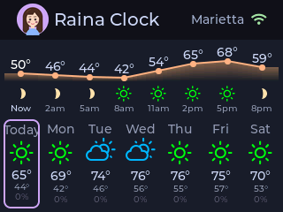 Weather: hourly graph and 7 days |
| 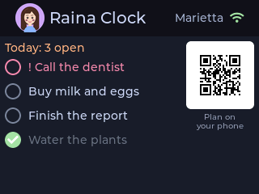 To-do with the QR code | 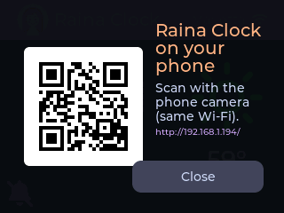 Open the phone page | 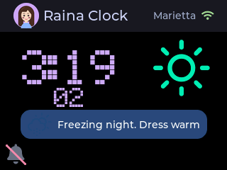 Freezing night |
| 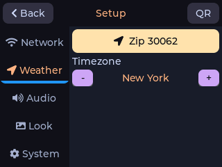 Setup: Weather | 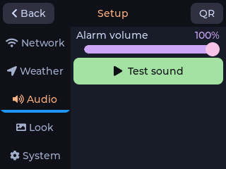 Setup: Audio | 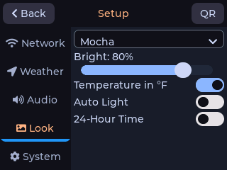 Setup: Look |

Phone pages:

  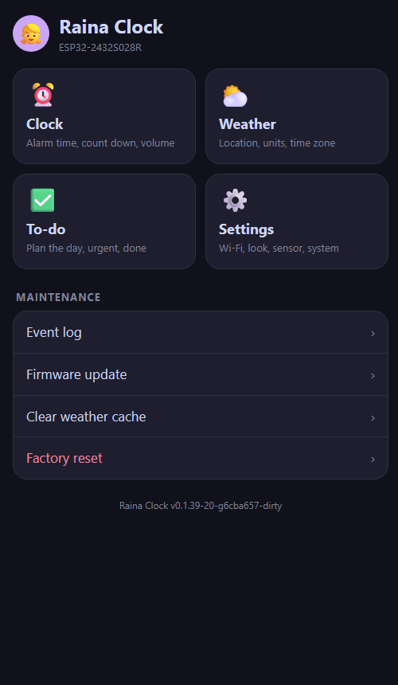
  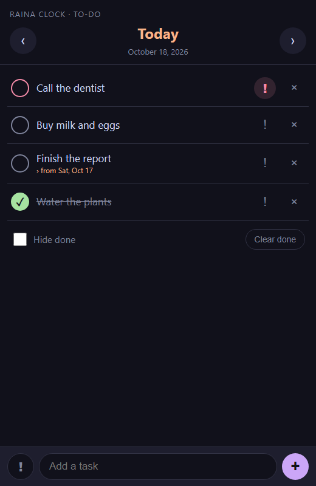

## Flows

### Moving between pages

There is no tab bar. A tap on any empty part of the screen slides up a menu of big buttons.

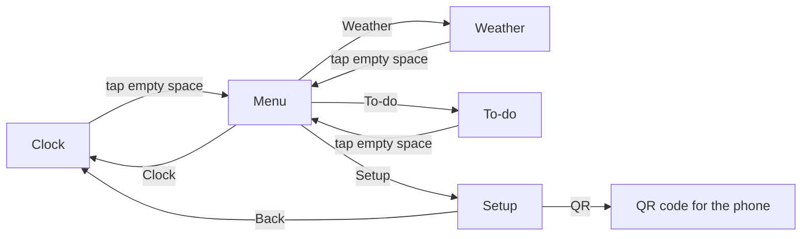

### Setting an alarm

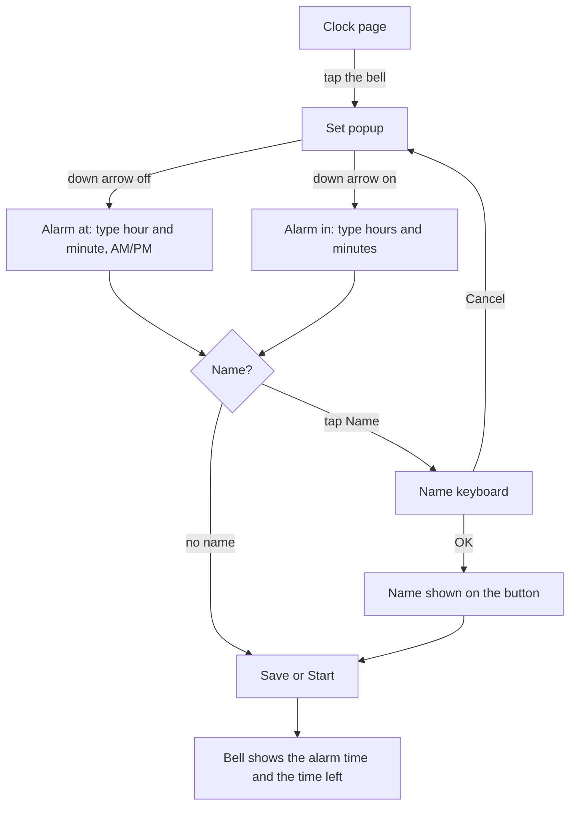

A name is kept only after you press **OK** on the keyboard and then **Save** (or **Start** for a count down).

### When the alarm rings

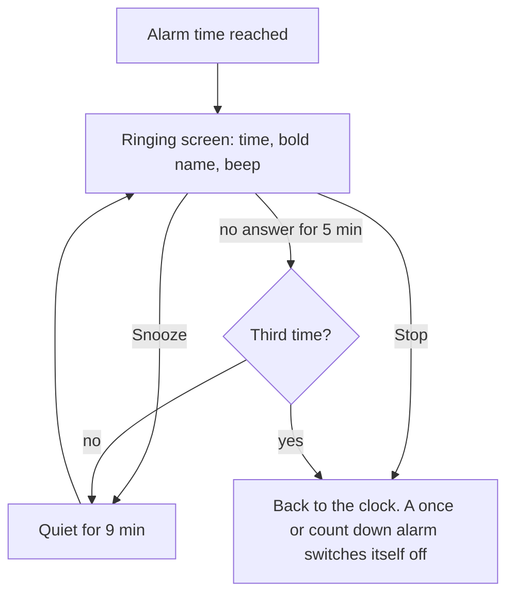

Snooze and Stop also work from the phone page `/alarm` and from the API.

### Choosing the weather message

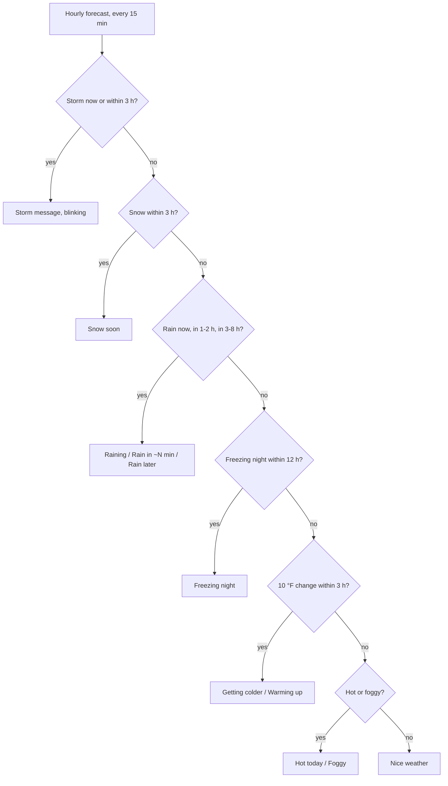

### First start and Wi-Fi

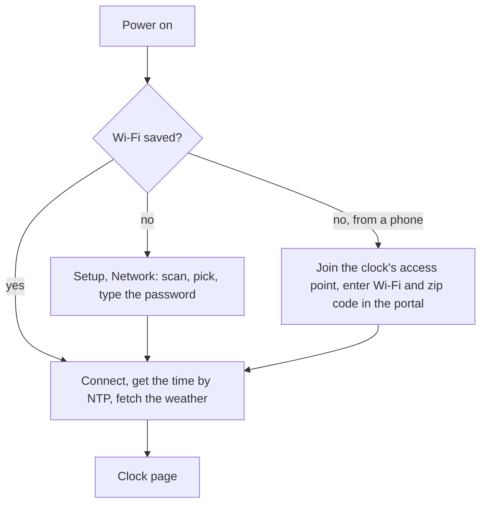

## Phone pages and API

From a phone on the same Wi-Fi, open `http://cyd-alarm-clock.local/`, or the clock's IP address shown under the QR code.

| Page | What it does |
|---|---|
| `/` | Home: Clock, Weather, To-do, Settings, plus maintenance (event log, firmware update, clear weather cache, factory reset) |
| `/alarm` | Name, wake in 6, 7 or 8 hours, exact time, every day, on/off, volume, snooze minutes, test and stop sound |
| `/todo` | The day's list: add, mark urgent, tick, delete, clear done, move between days |
| `/settings` | Wi-Fi, location, units, theme, time zone, sensor, MQTT |
| `/log` | Event log |
| `/update` | Firmware update over the air |

| API | Method | Purpose |
|---|---|---|
| `/api/alarm` | GET, POST | Read or change the alarm (`hour`, `minute`, `enabled`, `repeat`, `name`, `volume`, `snooze_minutes`, `in_hours`) |
| `/api/alarm/ring` | POST | Ring now (test) |
| `/api/alarm/snooze` | POST | Snooze |
| `/api/alarm/stop` | POST | Stop |
| `/api/alarm/test` | POST | Play the alarm sound |
| `/api/todo` | GET, POST | Read or replace the to-do list |
| `/api/config` | GET, POST | Settings |
| `/api/backup` | GET | What `/config.json` holds (the password length, not the password) |
| `/reset?confirm=yes` | | Factory reset (needs `confirm=yes`) |

Example:

    curl -X POST http://cyd-alarm-clock.local/api/alarm \
         -H "Content-Type: application/json" \
         -d '{"hour":6,"minute":30,"enabled":true,"repeat":true,"name":"school"}'

## Hardware

- **Board:** ESP32-2432S028R ("Cheap Yellow Display"), a 2.8" ILI9341 320x240 screen with resistive touch (XPT2046).
- **Speaker:** on the SPEAK connector (GPIO 26 through the on-board amplifier). The tiny built-in speaker works; a 4 ohm speaker is much louder.
- **Optional:** a DHT22 sensor and an SD card, as in the upstream project.
- **Other boards:** other CYD variants are listed in [docs/hardware-variants.md](docs/hardware-variants.md). This firmware is tested on the `cyd_28r` build.

## Case

The clock sits in a 3D-printed, battery-powered desk case tilted at 32 degrees (lilac, as in the photo at the top):

- **Model:** "CYD Desk Buddy for Bambu Lab / Home Assistant" by **annaglyph** on [MakerWorld](https://makerworld.com/).
- **Print profile:** "Battery Powered 32 Degree - 0.12mm layer, 2 walls, 15% infill" by **SFAJeff**. It adds room for a battery, a charger and a power button.
- **Battery parts** (from the profile):
  - a V713 USB-C 5V 2A boost converter and charger
  - an LP103665 3.7 V 3000 mAh LiPo battery
  - a JST 1.25 mm connector (or solder the battery)
  - a 6x6 mm push button
- **Licence:** the model is published under the MakerWorld Exclusive License, so the 3MF file is not included here. Download it from MakerWorld by searching for "CYD Desk Buddy".

## Build and flash

You need [PlatformIO](https://platformio.org/).

1. **Wi-Fi (optional):** copy `config/secrets.h.example` to `config/secrets.h` and fill in your Wi-Fi. You can also set Wi-Fi on the screen. `secrets.h` is git-ignored.
2. **Location:** set your zip code and time zone in `config/config.h`, or later in Setup. The defaults are 30062 and America/New_York.
3. **Build and flash:**

       pio run -e cyd_28r
       pio run -e cyd_28r -t upload --upload-port COM5

4. **Unit tests on the PC:**

       pio test -e native

The serial monitor runs at 115200 baud and takes these bench commands:

| Key | Action |
|---|---|
| `r` | Ring the alarm |
| `b` | Beep |
| `s` | Stop |
| `l` | Print the log |
| `h` | Show free memory |
| `t` | Turn the touch monitor on or off |

## Project layout

| Path | What |
|---|---|
| `src/ui_trip.cpp` | Clock page |
| `src/ui_alarm.cpp` | Bell, Set popup, name keyboard, ringing screen |
| `src/alarm_manager.cpp` | Alarm settings and snooze, stored in NVS |
| `src/weather_alert.cpp` | Weather message bubble and its rules |
| `src/ui_weather.cpp`, `src/weather_client.cpp` | Weather page and the Open-Meteo client |
| `src/ui_todo.cpp`, `src/todo_manager.cpp` | To-do page and storage |
| `src/ui_menu.cpp` | Slide-up page menu |
| `src/ui_wifi.cpp` | Wi-Fi scan, keyboard and zip code pages |
| `src/ui_qr.cpp` | QR codes for the phone pages |
| `src/audio_player.cpp` | Beep through the DAC |
| `src/event_log.cpp`, `src/config_backup.cpp` | Event log and the `/config.json` backup |
| `src/wifi_manager.cpp`, `include/*_html.h` | Web server and phone pages |
| `docs/PLAN.md` | The original plan |
| `docs/UPSTREAM_README.md` | The cyd-weather-station README (settings, MQTT and OTA details) |

## Credits and licenses

- [cyd-weather-station](https://github.com/nicholaswilde/cyd-weather-station) by Nicholas Wilde, Apache-2.0. This project keeps its license ([LICENSE](LICENSE)).
- Electronic Highway Sign font, from dafont.com, free per its author ([note](assets/fonts/ELECTRONIC-HIGHWAY-SIGN-NOTE.txt)).
- Weather Icons by Erik Flowers, SIL OFL 1.1.
- [LVGL](https://lvgl.io/) 8, MIT.
- ESP8266Audio by Earle F. Philhower III, GPL-3.0.
- Weather data from [Open-Meteo](https://open-meteo.com/), CC BY 4.0.
- `assets/music/fur_elise.mp3`: a Für Elise recording by JMC Han, CC BY-SA 4.0, via Wikimedia Commons. The firmware no longer uses it.
